# Contenido

- [Introducción](#introducción)
- [Objetivos de esta práctica](#objetivos-de-esta-práctica)
- [Requisitos](#requisitos)
- [1. Cuentas en Linux y restricción de SSH](#1-cuentas-en-linux-y-restricción-de-ssh)
  - [1.1 Crear los usuarios](#11-crear-los-usuarios)
  - [1.2 Crear el grupo y limitar SSH](#12-crear-el-grupo-y-limitar-ssh)
  - [1.3 Probar el acceso](#13-probar-el-acceso)
  - [1.4 Revocar y conceder el acceso](#14-revocar-y-conceder-el-acceso)
  - [1.5 Restringir también el escritorio remoto (xRDP)](#15-restringir-también-el-escritorio-remoto-xrdp)
- [2. Cuentas en Windows y escritorio remoto](#2-cuentas-en-windows-y-escritorio-remoto)
  - [2.1 Crear los usuarios](#21-crear-los-usuarios)
  - [2.2 Probar sin permiso](#22-probar-sin-permiso)
  - [2.3 Conceder el permiso por SID](#23-conceder-el-permiso-por-sid)
  - [2.4 Localizar los intentos en el Visor de eventos](#24-localizar-los-intentos-en-el-visor-de-eventos)
  - [2.5 Restringir también SSH en Windows](#25-restringir-también-ssh-en-windows)
- [3. Webmin y túnel SSH](#3-webmin-y-túnel-ssh)
  - [3.1 Instalar Webmin](#31-instalar-webmin)
  - [3.2 Acceder desde el navegador](#32-acceder-desde-el-navegador)
  - [3.3 Comprobar qué hace Webmin por debajo](#33-comprobar-qué-hace-webmin-por-debajo)
  - [3.4 Cerrar el puerto 10000](#34-cerrar-el-puerto-10000)
  - [3.5 Entrar por túnel SSH](#35-entrar-por-túnel-ssh)
- [4. Para ir más allá (opcional)](#4-para-ir-más-allá)
- [5. Lista de autoevaluación](#5-lista-de-autoevaluación)
- [6. Qué subir a tu repositorio de documentación](#6-qué-subir-a-tu-repositorio-de-documentación)

> **💡 Práctica no calificada**
>
> Esta práctica sirve para que compruebes por ti mismo que sabes hacerlo. No tiene nota: al final tienes una lista de autoevaluación para saber qué te falta repasar, y una guía de lo que debes subir a tu repositorio de documentación.

# Introducción

Imagina que acabas de incorporarte como técnico de sistemas en una pequeña empresa. Tiene un servidor Linux y un equipo Windows que se administran en remoto, y hasta ahora cualquier usuario con contraseña podía entrar en ellos por SSH o por escritorio remoto. Tu primera tarea es poner orden: decidir quién puede conectarse a cada máquina y por qué vía, y dejar un panel de administración web disponible para el equipo de sistemas sin exponerlo a la red.

Es una situación muy habitual. Muchas intrusiones no aprovechan un fallo técnico complicado, sino una cuenta que no debería tener acceso o un servicio que alguien dejó abierto. Por eso la idea central de esta práctica es el **mínimo privilegio**: cada usuario tiene solo el acceso que necesita, y cada servicio solo es accesible desde donde hace falta.

La práctica tiene tres partes:

- **Linux:** crearás dos usuarios, soporte e invitado, y harás que solo soporte pueda entrar por SSH y por escritorio remoto.

<!-- -->

- **Windows:** harás lo mismo en el equipo Windows, dando permiso de escritorio remoto a soporte y limitando el acceso SSH a un grupo.

- **Webmin:** instalarás un panel de administración web en el servidor Linux, cerrarás su puerto al exterior y entrarás en él a través de un túnel SSH.

En cada parte comprobarás tanto lo que debe funcionar como lo que no: que el usuario autorizado entra, que el no autorizado es rechazado y dónde queda registrado el rechazo. En un trabajo real, **saber demostrar que una restricción funciona es tan importante como configurarla**.

# Objetivos de esta práctica

| **Lo que habrás hecho**                                                                                                                      |
|----------------------------------------------------------------------------------------------------------------------------------------------|
| Creado cuentas de usuario para el acceso remoto en Linux y en Windows, sin privilegios de administración.                                    |
| Restringido el acceso por SSH a un grupo de usuarios, en Linux y en Windows, y comprobado que un usuario ajeno al grupo es rechazado.        |
| Restringido el acceso por escritorio remoto, en Windows con el SID (o con su nombre) del grupo y en Linux con xRDP, y comprobado el rechazo. |
| Instalado Webmin, cerrado su puerto 10000 al exterior y accedido a él a través de un túnel SSH.                                              |

# Requisitos

Usa las mismas máquinas de las prácticas de SSH y de RDP:

- Una máquina **Linux** (la ubuntu-gui de la práctica de RDP) con SSH y xRDP instalados y funcionando.

- Un equipo **Windows** con el Escritorio remoto activado y el servidor OpenSSH instalado y en marcha.

- Un cliente desde el que conectar a ambos (tu equipo anfitrión o una tercera máquina).

- Conexión a Internet en la máquina Linux, para descargar Webmin.

Todos los comandos de PowerShell se ejecutan en una consola abierta como administrador.

*Revisa que ambos servidores (Linux y Windows) tienen las configuraciones mínimas iniciales: Ip fija, nombre “significativo”, actualizaciones al día.*

# 1. Cuentas en Linux y restricción de SSH

En el servidor Linux se van a crear dos nuevos usuarios, un usuario *soporte* que tendrá acceso por SSH y RDP y otro usuario *invitado* que no tendrá acceso por ninguno de los dos medios.

## 1.1 Crear los usuarios

Crea dos usuarios normales: soporte, que podrá entrar por SSH, e invitado, que no. Ninguno debe ser administrador.

```bash
sudo adduser soporte
sudo adduser invitado
```

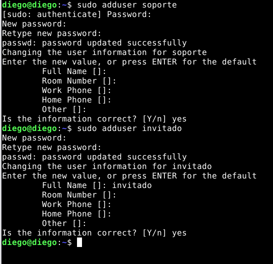

## 1.2 Crear el grupo y limitar SSH

Crea el grupo sshusers y añade a él a soporte y también a tu propio usuario administrador, para no quedarte fuera:

```bash
sudo groupadd sshusers
sudo usermod -aG sshusers soporte
sudo usermod -aG sshusers tu_usuario
```


Crea el fichero de configuración, comprueba la sintaxis y reinicia el servicio:

```bash
sudo nano /etc/ssh/sshd_config.d/10-acceso.conf
# Contenido
AllowGroups sshusers
```

```bash
sudo sshd -t && sudo systemctl restart ssh
sudo sshd -T | grep -i allowgroups
```

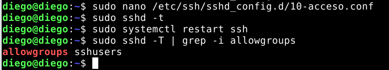

> **⚠ Atención**
>
> Antes de cerrar tu sesión actual, abre una segunda terminal y comprueba que sigues pudiendo entrar con tu usuario.

## 1.3 Probar el acceso

Desde el cliente, prueba los dos usuarios. Usa la contraseña correcta en ambos:

```bash
ssh soporte@ip_del_servidor
ssh invitado@ip_del_servidor
```

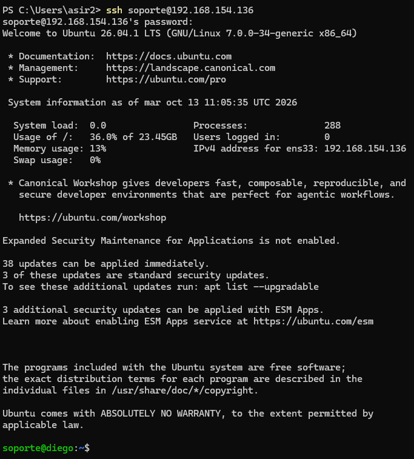

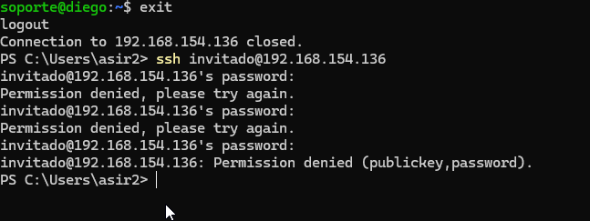

Anota qué ocurre en cada caso. Después, en el servidor, busca el motivo del rechazo en el registro y copia la línea:

```bash
sudo journalctl -u ssh | grep "not allowed"
```

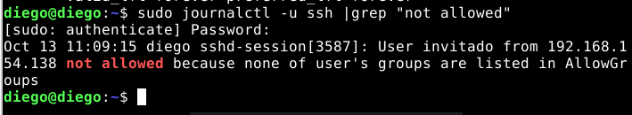

## 1.4 Revocar y conceder el acceso

Quita a soporte del grupo, comprueba que ya no puede entrar y vuelve a darle acceso. No debes tocar el fichero de configuración:

```bash
sudo gpasswd -d soporte sshusers
# Probar: ssh soporte@ip_del_servidor
sudo usermod -aG sshusers soporte
```

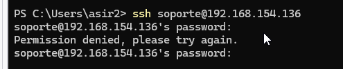

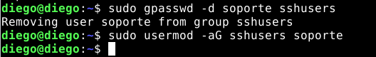

## 1.5 Restringir también el escritorio remoto (xRDP)

Hasta ahora has restringido SSH. El usuario invitado, sin embargo, aún puede entrar por escritorio remoto. Compruébalo desde Windows con mstsc: inicia sesión en la máquina Linux con invitado. Debería dejarte entrar, porque xRDP no restringe a nadie mientras no exista el grupo tsusers.

Ahora crea el grupo, añade a soporte y a tu usuario administrador, y reinicia los servicios de xRDP:

```bash
sudo groupadd tsusers
sudo usermod -aG tsusers soporte
sudo usermod -aG tsusers tu_usuario
sudo systemctl restart xrdp xrdp-sesman
```

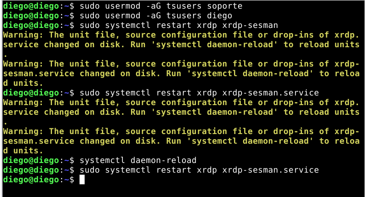

Prueba con una conexión nueva: soporte debe entrar e invitado debe ser rechazado, aunque la contraseña sea correcta. Después busca el motivo en el registro y copia la línea:

```bash
sudo tail -n 30 /var/log/xrdp-sesman.log
```

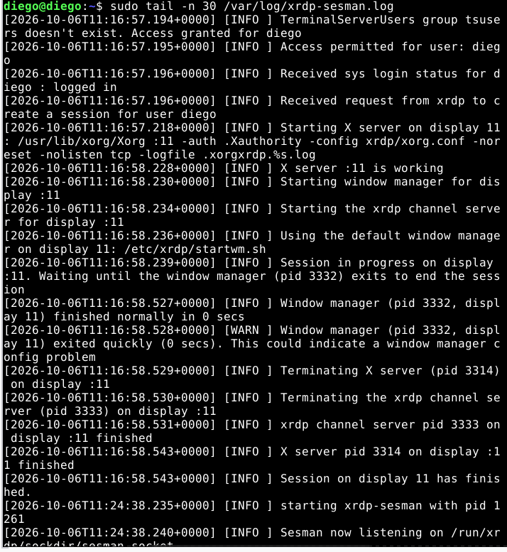

Por último, quita a soporte del grupo con gpasswd, comprueba que ya no entra, y vuelve a darle acceso.

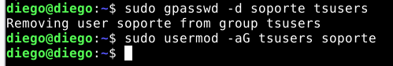

# 2. Cuentas en Windows y escritorio remoto

En el servidor Windows se van a crear dos nuevos usuarios, un usuario *soporte* que tendrá acceso por SSH y RDP y otro usuario *invitado* que no tendrá acceso por ninguno de los dos medios.

## 2.1 Crear los usuarios

En el equipo Windows, crea los usuarios soporte e invitado pidiendo la contraseña sin mostrarla (usa la misma para los dos, solo es una prueba):

```powershell
$clave = Read-Host -AsSecureString "Contraseña"
New-LocalUser -Name "soporte" -Password $clave -FullName "Usuario de soporte"
New-LocalUser -Name "invitado" -Password $clave -FullName "Usuario invitado"
```

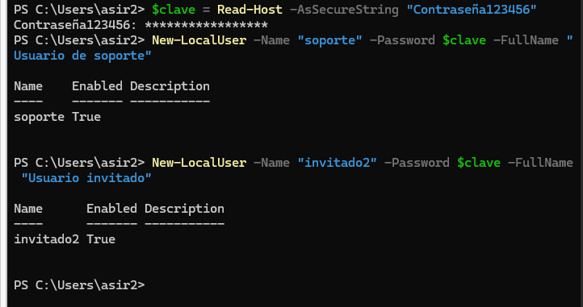

## 2.2 Probar sin permiso

Desde el cliente, abre Conexión a Escritorio remoto (mstsc) e intenta entrar con soporte. Anota el mensaje que aparece.

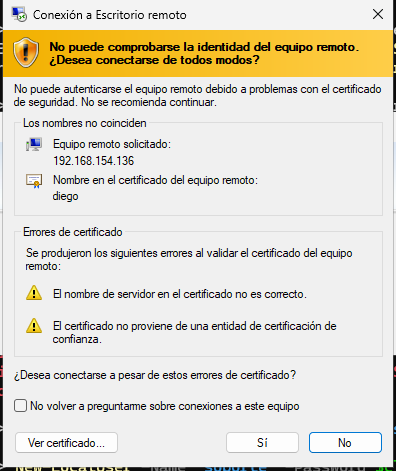

## 2.3 Conceder el permiso por SID

```powershell
Add-LocalGroupMember -SID S-1-5-32-555 -Member "soporte"
Get-LocalGroupMember -SID S-1-5-32-555
```

Comprueba que soporte aparece en la lista y vuelve a intentar la conexión. Ahora debe entrar.

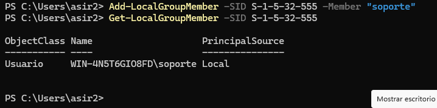

## 2.4 Localizar los intentos en el Visor de eventos

En el equipo Windows, abre el Visor de eventos, ve a Registros de Windows, Seguridad, y localiza el suceso 4625 (inicio de sesión fallido) de tu primer intento y el suceso 4624 (inicio de sesión correcto) del segundo. Anota la hora de cada uno.

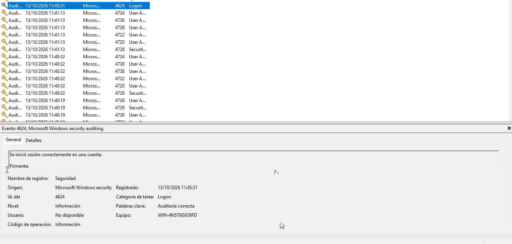

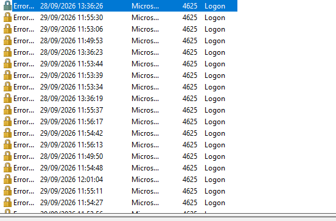

## 2.5 Restringir también SSH en Windows

Ahora limita quién puede entrar por SSH en la máquina Windows. Crea un grupo local y añade a soporte y a tu usuario administrador, para no quedarte fuera:

```powershell
New-LocalGroup -Name "sshusers" -Description "Usuarios con acceso SSH"
Add-LocalGroupMember -Group "sshusers" -Member "soporte"
Add-LocalGroupMember -Group "sshusers" -Member "tu_usuario"
```

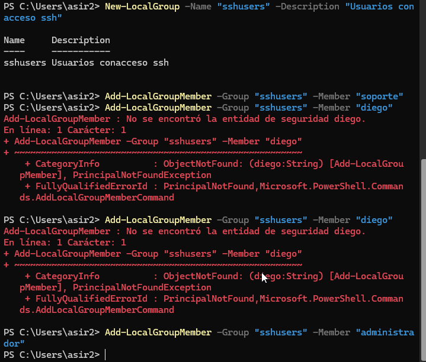

Abre el fichero de configuración del servidor OpenSSH con el Bloc de notas. Hazlo desde la misma consola de PowerShell abierta como administrador: si lo abres de otra forma, Windows no te dejará guardar los cambios aunque tu usuario sea administrador.

```bash
notepad C:\ProgramData\ssh\sshd_config
```

Busca si ya hay una línea que empiece por AllowGroups (en Windows Server 2025 viene una de serie). Si existe, sustitúyela por la línea de abajo; si no existe, añádela. En los dos casos tiene que quedar **antes** del bloque Match Group administrators que hay al final del fichero:

```bash
AllowGroups sshusers
```

> **⚠ Atención**
>
> Todo lo que se escribe después de una línea Match solo se aplica a ese bloque. Si pones AllowGroups al final del fichero, solo afectará a los administradores y el resto de usuarios seguirá entrando sin restricción.

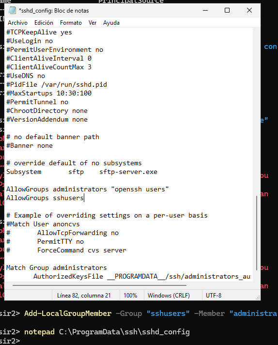

Comprueba la sintaxis antes de aplicar el cambio y reinicia el servicio:

```powershell
& "$env:windir\System32\OpenSSH\sshd.exe" -t
Restart-Service sshd
```

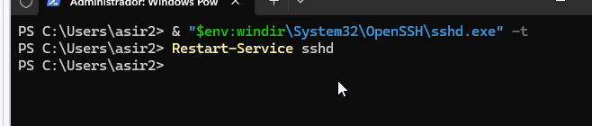

> **⚠ Atención**
>
> Antes de cerrar tu sesión actual, abre una segunda terminal y comprueba que sigues pudiendo entrar con tu usuario administrador.

Desde el cliente, prueba ssh con soporte (debe entrar) y con invitado (debe ser rechazado, aunque la contraseña sea correcta). Después, en Windows, abre el Visor de eventos, ve a Registros de aplicaciones y servicios, OpenSSH, Operational, y localiza el motivo del rechazo. Anota la hora. Por último, quita a soporte del grupo con Remove-LocalGroupMember, comprueba que ya no entra y vuelve a darle acceso.

# 3. Webmin y túnel SSH

Webmin es un panel de administración web para Linux que escucha, por defecto, en el puerto 10000. En esta parte lo instalarás en la máquina Linux, comprobarás quién puede entrar y qué hace por debajo y, al final, cerrarás el puerto para que solo se pueda llegar a él a través de un túnel SSH.

Salvo que se indique que algo se hace en el cliente, los comandos de esta parte se ejecutan en la máquina Linux.

## 3.1 Instalar Webmin

Webmin no está en los repositorios de Ubuntu. Primero hay que descargar y ejecutar el script oficial, que añade su repositorio y su clave de firma:

```bash
sudo apt update
sudo apt install curl -y
curl -o webmin-setup-repo.sh \
https://raw.githubusercontent.com/webmin/webmin/masudoster/webmin-setup-repo.sh
sudo sh webmin-setup-repo.sh
```

El script te preguntará si quieres configurar el repositorio de Webmin: responde y. Después instala el paquete:

```bash
sudo apt install webmin --install-recommends -y
```

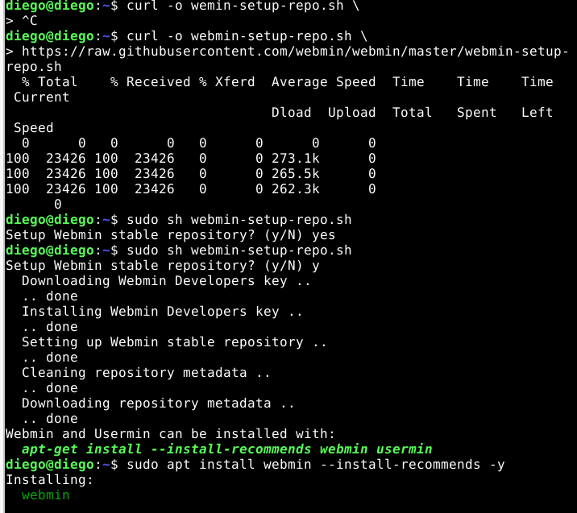

Comprueba que el servicio está en marcha y en qué dirección y puerto escucha:

```bash
systemctl status webmin
sudo ss -tlnp | grep 10000
```

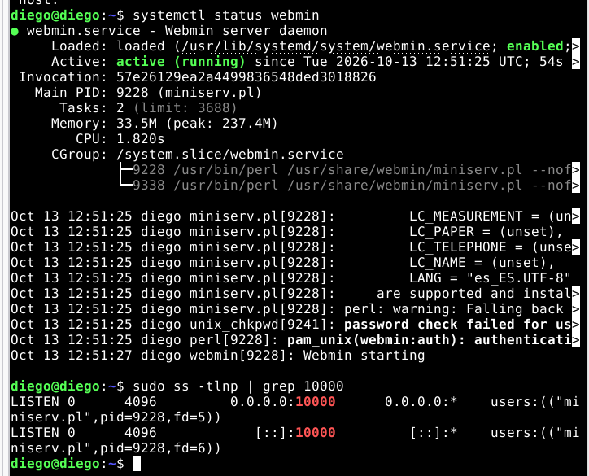

Anota lo que aparece en la columna de la dirección local. Una dirección como 0.0.0.0:10000 significa que Webmin acepta conexiones desde cualquier red.

> **💡 Nota**
>
> Ejecutar con sudo un script descargado de Internet exige confiar en quien lo publica. Si quieres ver qué hace antes de lanzarlo, ábrelo con less webmin-setup-repo.sh.

## 3.2 Acceder desde el navegador

Comprueba el estado del cortafuegos del servidor:

```bash
sudo ufw status
```

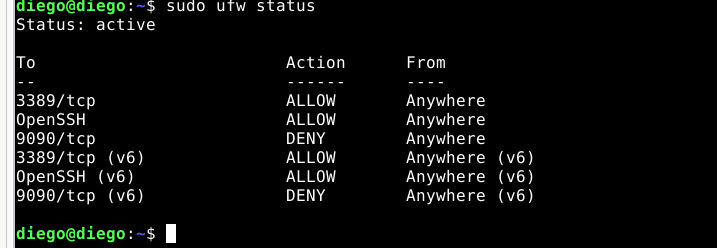

Si aparece **Status: active**, el puerto 10000 está bloqueado: ábrelo de forma temporal para hacer la prueba.

```bash
sudo ufw allow 10000/tcp
```

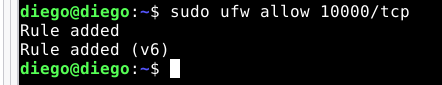

Si aparece **Status: inactive**, no hace falta hacer nada: el cortafuegos no está filtrando y el puerto ya es accesible.

Desde el cliente, abre *https://ip_del_servidor:10000*. El navegador avisará de que el certificado no es de confianza, porque Webmin usa uno autofirmado: acepta el aviso para continuar.

Entra con tu usuario administrador (el que tiene permisos de sudo) y explora el menú System. Después cierra sesión con el botón de salida e intenta entrar con soporte. Anota qué ocurre con cada usuario.

> **💡 Nota**
>
> En Ubuntu, Webmin solo deja entrar a root y a los usuarios que pueden ejecutar cualquier comando con sudo. Un usuario normal como soporte es rechazado, aunque su contraseña sea correcta. Si has visto Cockpit en clase, compara: allí cualquier usuario del sistema podía entrar, aunque con acceso limitado.

## 3.3 Comprobar qué hace Webmin por debajo

Un panel de administración no hace nada que no puedas hacer desde la terminal: cada clic acaba siendo un comando. Compruébalo con un servicio:

- En Webmin, ve a System, Bootup and Shutdown, marca el servicio cron y pulsa Stop.

- En la terminal del servidor, comprueba su estado con systemctl status cron. Debe aparecer como inactivo.

- Vuelve a arrancarlo desde Webmin con Start y comprueba de nuevo el estado en la terminal.

Después, abre System, Running Processes y busca el proceso de Webmin (miniserv.pl). Comprueba que es el mismo que viste con ss en el apartado 3.1.

## 3.4 Cerrar el puerto 10000

Ahora vas a dejar Webmin accesible solo para quien pueda entrar por SSH.

**Si el cortafuegos estaba activo,** borra la regla que añadiste:

```bash
sudo ufw delete allow 10000/tcp
sudo ufw status
```

**Si estaba inactivo,** actívalo. Antes permite SSH y el escritorio remoto, que usas en esta misma máquina: con la política por defecto, todo lo que no permitas quedará bloqueado, incluido el puerto 10000.

```bash
sudo ufw allow OpenSSH
sudo ufw allow 3389/tcp
sudo ufw enable
sudo ufw status
```

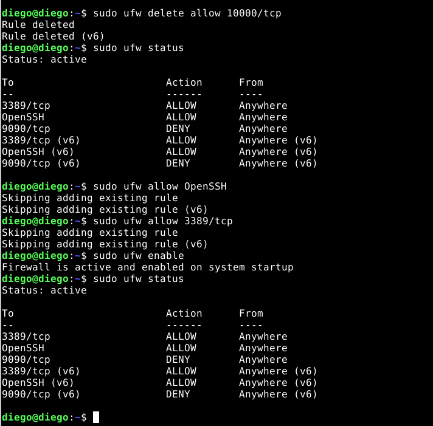

> **⚠ Atención**
>
> Permite SSH antes de activar el cortafuegos. Si lo activas sin esa regla mientras estás conectado por SSH, perderás la conexión.

En la salida de ufw status verás cada regla dos veces, una de ellas con (v6): es la misma regla aplicada a IPv6.

Comprueba desde el cliente que el puerto 10000 ya no responde y que el 22 sí. En Windows, en PowerShell:

```powershell
Test-NetConnection ip_del_servidor -Port 10000
Test-NetConnection ip_del_servidor -Port 22
```

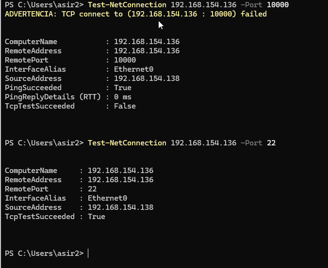

El primero debe mostrar TcpTestSucceeded : False y el segundo, True. Fíjate en que el comando es Test-NetConnection, no Test-Connection (ese último solo hace ping). Si tu cliente es Linux, usa nc -zv ip_del_servidor 10000. Comprueba también que https://ip_del_servidor:10000 ya no carga en el navegador.

## 3.5 Entrar por túnel SSH

En el cliente, abre el túnel y deja la ventana abierta mientras uses Webmin:

```bash
ssh -L 10000:localhost:10000 soporte@ip_del_servidor
```

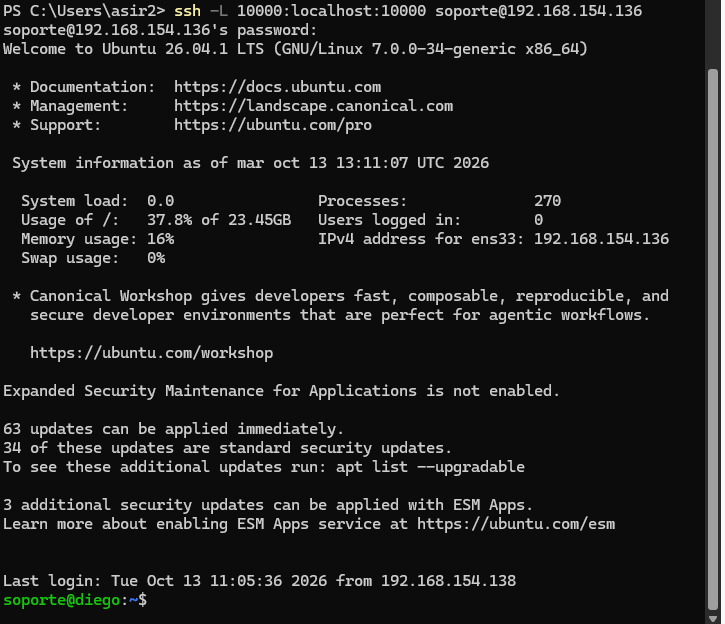

Abre https://localhost:10000 en el navegador del cliente y entra con tu usuario administrador. Debes llegar a Webmin aunque el puerto esté cerrado. El navegador volverá a avisar del certificado, porque ahora la dirección es distinta.

Fíjate en que hay dos inicios de sesión distintos: el túnel lo abre soporte, que tiene permiso de SSH, y en Webmin entras con tu usuario administrador. Para llegar al panel hay que superar los dos.

Para comprobar que es el túnel lo que te da acceso, abre otra consola en el cliente y ejecuta netstat -an \| findstr 10000 en Windows, o ss -tln \| grep 10000 en Linux. Verás el puerto 10000 escuchando en 127.0.0.1 de tu propio equipo: quien escucha es el cliente ssh. Por último, cierra la sesión SSH y recarga el navegador: Webmin deja de responder.

# 4. Para ir más allá

- **Webmin solo en localhost:** el cortafuegos bloquea el puerto 10000, pero Webmin sigue escuchando en todas las interfaces, y si alguien desactivara ufw volvería a estar expuesto. Haz que solo escuche en el propio servidor: añade la línea bind=127.0.0.1 al fichero /etc/webmin/miniserv.conf, reinicia con sudo systemctl restart webmin y comprueba con sudo ss -tlnp \| grep 10000 que ahora escucha en 127.0.0.1. Si sigue apareciendo una línea con \[::\]:10000, cambia también en ese fichero ipv6=1 por ipv6=0 y reinicia. Comprueba que el túnel sigue funcionando y explica qué ventaja tiene esto frente a confiar solo en el cortafuegos.

- **Túnel sin shell y con clave:** abre el túnel con ssh -N -L 10000:localhost:10000 soporte@ip_del_servidor usando tu clave SSH en lugar de la contraseña. Explica qué hace la opción -N.

# 5. Lista de autoevaluación

Marca lo que has conseguido. Esta lista no tiene nota: sirve para que sepas qué te falta repasar antes de la prueba.

|     | **Compruébalo**                                                                                                                                                   |
|-----|-------------------------------------------------------------------------------------------------------------------------------------------------------------------|
| ☐   | Creé los usuarios soporte e invitado en Linux sin darles privilegios de administración.                                                                           |
| ☐   | Restringí SSH con AllowGroups y comprobé la sintaxis con sshd -t antes de reiniciar.                                                                              |
| ☐   | Comprobé que invitado es rechazado aunque su contraseña sea correcta y localicé el motivo en el registro.                                                         |
| ☐   | Quité y devolví el acceso a soporte cambiando solo su pertenencia al grupo.                                                                                       |
| ☐   | Restringí xRDP creando el grupo tsusers, comprobé el rechazo de invitado y localicé el motivo en xrdp-sesman.log.                                                 |
| ☐   | Creé el usuario en Windows sin escribir la contraseña en claro en el comando.                                                                                     |
| ☐   | Di acceso por escritorio remoto usando el SID del grupo y comprobé la pertenencia.                                                                                |
| ☐   | Localicé en el Visor de eventos el intento fallido y el correcto.                                                                                                 |
| ☐   | Restringí SSH en Windows con AllowGroups, colocando la línea antes del bloque Match, comprobé la sintaxis con sshd.exe -t y vi el rechazo en el Visor de eventos. |
| ☐   | Instalé Webmin desde su repositorio oficial y comprobé en qué dirección y puerto escucha.                                                                         |
| ☐   | Entré en Webmin con mi usuario administrador, comprobé qué ocurre con soporte y sé explicar por qué.                                                              |
| ☐   | Paré y arranqué un servicio desde Webmin y comprobé el cambio con systemctl.                                                                                      |
| ☐   | Cerré el puerto 10000 con ufw sin perder el acceso por SSH y lo comprobé desde el cliente.                                                                        |
| ☐   | Accedí a Webmin a través de un túnel SSH y sé explicar con mis palabras qué hace -L 10000:localhost:10000.                                                        |

# 6. Qué subir a tu repositorio de documentación

Crea en tu repositorio una carpeta para esta práctica con un fichero README.md que incluya:

- **Resumen con tus palabras:** mínimo privilegio, AllowGroups en Linux y en Windows, el SID del grupo de escritorio remoto, tsusers en xRDP, qué es un túnel SSH y por qué no se expone un panel de administración a la red.

- **Comandos que has usado,** como texto y con su salida, no solo capturas.

- **Capturas:** el rechazo de invitado por SSH y por escritorio remoto en las dos máquinas, la línea del registro con not allowed, el mensaje de Windows sin permiso, los sucesos 4625 y 4624, el rechazo de soporte en Webmin, la comprobación del puerto 10000 cerrado y Webmin abierto a través del túnel.

- **Problemas y soluciones:** qué falló, cómo lo averiguaste y qué hiciste para arreglarlo.

> **💡 Nota**
>
> Todo lo que subas debe poder explicarse. La profesora puede pedirte una breve explicación oral de cualquier evidencia de tu repositorio.
