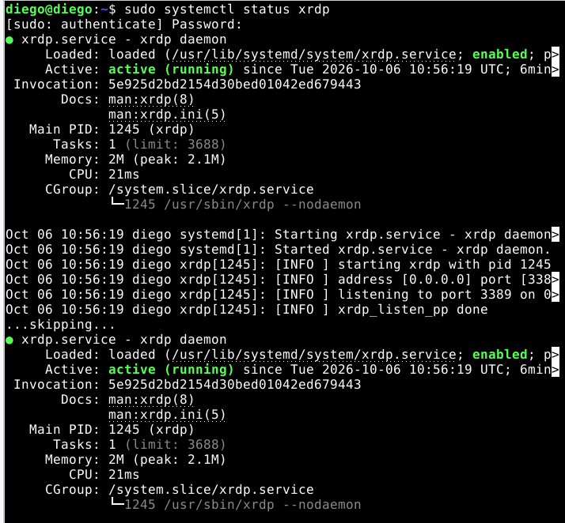
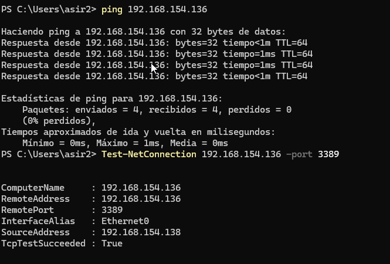
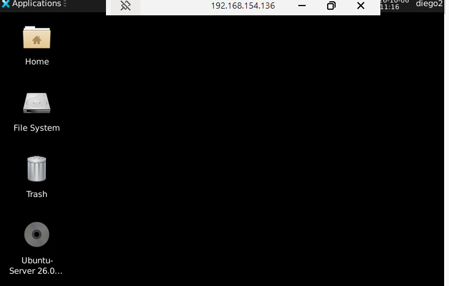

# Contenido

- [Objetivo de la práctica](#objetivo-de-la-práctica)
- [Escenario](#escenario)
- [Parte 1. Preparar la máquina ubuntu-gui](#parte-1-preparar-la-máquina-ubuntu-gui)
  - [1.1 Entorno de escritorio](#11-entorno-de-escritorio)
  - [1.2 Instalar y configurar xRDP](#12-instalar-y-configurar-xrdp)
  - [1.3 Comprobar que el servicio escucha](#13-comprobar-que-el-servicio-escucha)
- [Parte 2. De Windows a Ubuntu](#parte-2-de-windows-a-ubuntu)
  - [2.1 Comprobar la conectividad y el puerto](#21-comprobar-la-conectividad-y-el-puerto)
  - [2.2 Conectar con el cliente de Windows](#22-conectar-con-el-cliente-de-windows)
- [Parte 3. De Ubuntu a Windows](#parte-3-de-ubuntu-a-windows)
  - [3.1 Habilitar el Escritorio remoto en Windows](#31-habilitar-el-escritorio-remoto-en-windows)
  - [3.2 Instalar el cliente en ubuntu-gui](#32-instalar-el-cliente-en-ubuntu-gui)
  - [3.3 Conectar con Remmina](#33-conectar-con-remmina)
- [Parte 4. Comprobar quién se ha conectado](#parte-4-comprobar-quién-se-ha-conectado)
  - [4.1 En Windows](#41-en-windows)
  - [4.2 En Ubuntu](#42-en-ubuntu)
  - [4.3 Anotar problemas y soluciones](#43-anotar-problemas-y-soluciones)
- [Lista de autoevaluación](#lista-de-autoevaluación)
- [Qué subir a tu repositorio de documentación](#qué-subir-a-tu-repositorio-de-documentación)

> **📓 Antes de empezar**
>
> Esta práctica da por hecho que ya has trabajado el documento de teoría de RDP. Aquí no se repiten las explicaciones, solo se indica el apartado de la teoría al que debes volver cuando haga falta.

# Objetivo de la práctica

Montar una máquina virtual Ubuntu con escritorio y comprobar el acceso por escritorio remoto en los dos sentidos: desde Windows hacia Ubuntu y desde Ubuntu hacia Windows. Al terminar, dejarás constancia de todo el proceso en tu repositorio de documentación.

> **🎓 Esta práctica no se califica**
>
> Es una práctica de aprendizaje, no de evaluación: su objetivo es que consolides los conceptos de la teoría con las manos en el teclado. Al final tienes una lista de autoevaluación para que compruebes tú mismo si lo dominas. La evaluación del RA4 se hará más adelante con un cuestionario, una prueba práctica en condiciones de examen y la valoración de tu repositorio de documentación.

# Escenario

Necesitas dos máquinas en la misma red, con conectividad entre ellas:

| **Máquina** | **Sistema**                 | **Papel en la práctica**                                                     |
|-------------|-----------------------------|------------------------------------------------------------------------------|
| windows     | Windows Server o Windows 11 | Cliente en la parte 2 y servidor en la parte 3.                              |
| ubuntu-gui  | Ubuntu con escritorio       | Servidor RDP en la parte 2 (con xRDP) y cliente en la parte 3 (con Remmina). |

> **💡 Nota**
>
> ubuntu-gui es una máquina nueva. Puedes crearla de dos maneras: instalando Ubuntu Desktop desde cero, o clonando tu Ubuntu Server y añadiéndole el entorno de escritorio xfce4 (se hace en la parte 1). Si la clonas, genera una MAC nueva para su adaptador de red y arranca la máquina: recibirá otra IP por DHCP, y es esa nueva IP la que debes usar para conectar, no la del original. Todos los comandos de PowerShell se ejecutan en una consola abierta como administrador.

# Parte 1. Preparar la máquina ubuntu-gui

## 1.1 Entorno de escritorio

Si has instalado Ubuntu Desktop, ya lo tienes y puedes pasar al apartado 1.2. Si partes de un Ubuntu Server (o de un clon suyo), instala XFCE como indica el requisito previo del apartado 3 de la teoría:

```bash
sudo apt update
sudo apt install xfce4 xfce4-goodies dbus-x11 -y
```

El paquete dbus-x11 aporta dbus-launch. Sin él, la sesión de XFCE se abre pero muestra un error y te expulsa.

## 1.2 Instalar y configurar xRDP

Sigue los apartados 3.1 a 3.5 de la teoría. En resumen, debes dejar hecho esto:

1.  Instalar el paquete **xrdp**.

<!-- -->

1.  Añadir el usuario xrdp al grupo **ssl-cert**.

2.  Si ves una pantalla negra, aplicar el arreglo de **startwm.sh** del apartado 3.4.

3.  Abrir el puerto 3389 en el firewall si ufw está activo.

## 1.3 Comprobar que el servicio escucha

```bash
sudo systemctl status xrdp
sudo ss -tlnp | grep 3389
ip a
```



Anota la dirección IP de ubuntu-gui: la necesitarás en la parte 2.

> **⚠ Atención**
>
> Si al conectar ves una pantalla negra o un escritorio vacío aunque hayas hecho todo lo anterior, la sesión no sabe qué entorno arrancar. Con el usuario con el que vas a conectar, crea el fichero de sesión y vuelve a probar. Si en cambio ves un error que menciona dbus-launch, instala dbus-x11 como en el apartado 1.1:

```bash
echo "xfce4-session" > ~/.xsession
```

# Parte 2. De Windows a Ubuntu

## 2.1 Comprobar la conectividad y el puerto

Desde la máquina windows, comprueba primero la red y después el puerto de RDP:

```powershell
ping <ip_de_ubuntu-gui>
Test-NetConnection <ip_de_ubuntu-gui> -Port 3389
```



El ping solo demuestra que hay red entre las dos máquinas. La segunda orden debe mostrar TcpTestSucceeded : True, que indica que xRDP está escuchando y el firewall permite el paso.

## 2.2 Conectar con el cliente de Windows

Abre mstsc (Conexión a Escritorio remoto), escribe la IP de ubuntu-gui e inicia sesión con un usuario de Ubuntu. Antes del escritorio verás la pantalla de inicio de sesión de xRDP: deja la sesión Xorg, que es la opción por defecto, y escribe el usuario y la contraseña de **Linux**, no los de Windows. Deberías ver el escritorio de Ubuntu. Haz una captura.



# Parte 3. De Ubuntu a Windows

## 3.1 Habilitar el Escritorio remoto en Windows

En la máquina windows, sigue el apartado 2.1 de la teoría para activar el Escritorio remoto. Después, si vas a entrar con un usuario que no es administrador, añádelo al grupo de escritorio remoto usando el SID del grupo, no su nombre:

```powershell
Add-LocalGroupMember -SID S-1-5-32-555 -Member "nombre_usuario"
Get-LocalGroupMember -SID S-1-5-32-555
```

> **⚠ Atención**
>
> En un Windows en español, el grupo no se llama "Remote Desktop Users" y el comando net localgroup con ese nombre falla. El SID S-1-5-32-555 es el mismo en cualquier idioma. Con la regla de firewall pasa igual: si el comando de la teoría no encuentra el grupo "Remote Desktop", usa el nombre localizado "Escritorio remoto" o la regla por su nombre interno:

```powershell
Enable-NetFirewallRule -Name "RemoteDesktop-UserMode-In-*"
```

Anota la IP de la máquina windows con ipconfig.

## 3.2 Instalar el cliente en ubuntu-gui

Dentro del escritorio de ubuntu-gui (en la consola local o en la sesión RDP que abriste en la parte 2), abre una terminal e instala Remmina con su complemento RDP:

```bash
sudo apt update
sudo apt install remmina remmina-plugin-rdp -y
```

> **💡 Nota**
>
> Sin el complemento remmina-plugin-rdp, Remmina no ofrece el protocolo RDP. Si estás trabajando dentro de la sesión RDP que abriste desde Windows, estarás usando RDP dentro de RDP: funciona, pero la imagen puede ir más lenta. Es suficiente para la práctica.

## 3.3 Conectar con Remmina

Abre Remmina, crea una conexión nueva, elige el protocolo **RDP**, escribe la IP de la máquina windows y el usuario y la contraseña de Windows. Si todo va bien, verás el escritorio de Windows. Haz una captura.

# Parte 4. Comprobar quién se ha conectado

## 4.1 En Windows

Abre el Visor de eventos, ve a Registros de Windows, Seguridad, y localiza el suceso 4624 de la conexión que acabas de hacer desde Ubuntu. Si probaste alguna vez con una contraseña incorrecta, localiza también el 4625. Anota la hora y el usuario.

## 4.2 En Ubuntu

Mira qué ha registrado xRDP de tu conexión desde Windows:

```bash
sudo tail -n 30 /var/log/xrdp.log
```

## 4.3 Anotar problemas y soluciones

Apunta cualquier problema que hayas encontrado, cómo lo averiguaste y qué hiciste para arreglarlo. Es especialmente valioso si te tocó resolver la pantalla negra de xRDP o un rechazo por permisos.

> **☁ Bonus opcional con AWS**
>
> Si quieres ir un paso más allá, repite la parte 2 contra una instancia EC2 con Windows Server. Al lanzarla, AWS te permite descifrar la contraseña de administrador con tu par de claves (.pem) y desde ahí conectas por RDP igual que en la práctica. Recuerda que el puerto 3389 se abre en el grupo de seguridad solo para tu IP.

# Lista de autoevaluación

Marca lo que has conseguido. Esta lista no tiene nota: sirve para que sepas qué te falta repasar antes de la prueba.

|     | **Compruébalo**                                                                                                   |
|-----|-------------------------------------------------------------------------------------------------------------------|
| ☐   | He montado ubuntu-gui con entorno de escritorio y xRDP, y sé para qué sirve el grupo ssl-cert.                    |
| ☐   | He comprobado con ss y con Test-NetConnection que el puerto 3389 está escuchando y accesible.                     |
| ☐   | He resuelto, o sé cómo resolver, el problema de la pantalla negra de xRDP.                                        |
| ☐   | Me he conectado por RDP desde Windows a Ubuntu y he visto el escritorio remoto.                                   |
| ☐   | He activado el Escritorio remoto en Windows y sé dar acceso a un usuario normal usando el SID del grupo.          |
| ☐   | Me he conectado por RDP desde Ubuntu a Windows con Remmina.                                                       |
| ☐   | He localizado en el Visor de eventos y en xrdp.log quién se conectó y cuándo.                                     |
| ☐   | Sé explicar qué protege NLA y por qué no se debe exponer el puerto 3389 a internet.                               |
| ☐   | Sé explicar con mis palabras la diferencia entre un servicio orientado a sesión (RDP) y uno que no lo está (SSH). |
| ☐   | He subido a mi repositorio el resumen, las capturas, los comandos y la reflexión de esta práctica.                |

# Qué subir a tu repositorio de documentación

En la carpeta de esta unidad de trabajo, añade un fichero README.md (o uno por práctica) que incluya:

- **Resumen de teoría con tus palabras:** qué es RDP, puerto y NLA, quién puede conectarse, y la diferencia con SSH. No un copia y pega del documento de teoría.

<!-- -->

- **Comandos que has usado,** como texto y con su salida, con una frase explicando qué hace cada uno.

- **Capturas:** las dos conexiones (Windows a Ubuntu y Ubuntu a Windows) y los sucesos 4624 o 4625 del Visor de eventos.

- **Problemas y soluciones:** qué falló, cómo lo averiguaste y qué hiciste para arreglarlo.

- **Reflexión de 3 a 5 líneas:** ¿en qué situaciones usarías RDP en vez de SSH para administrar un servidor, y viceversa?

> **💡 Nota**
>
> Este es el material sobre el que se valorará el criterio de documentación del RA4, así que cuídalo como si fuera a evaluarse, aunque esta práctica en concreto no lleve nota. Todo lo que subas debe poder explicarse: la profesora puede pedirte una breve explicación oral de cualquier evidencia de tu repositorio.
